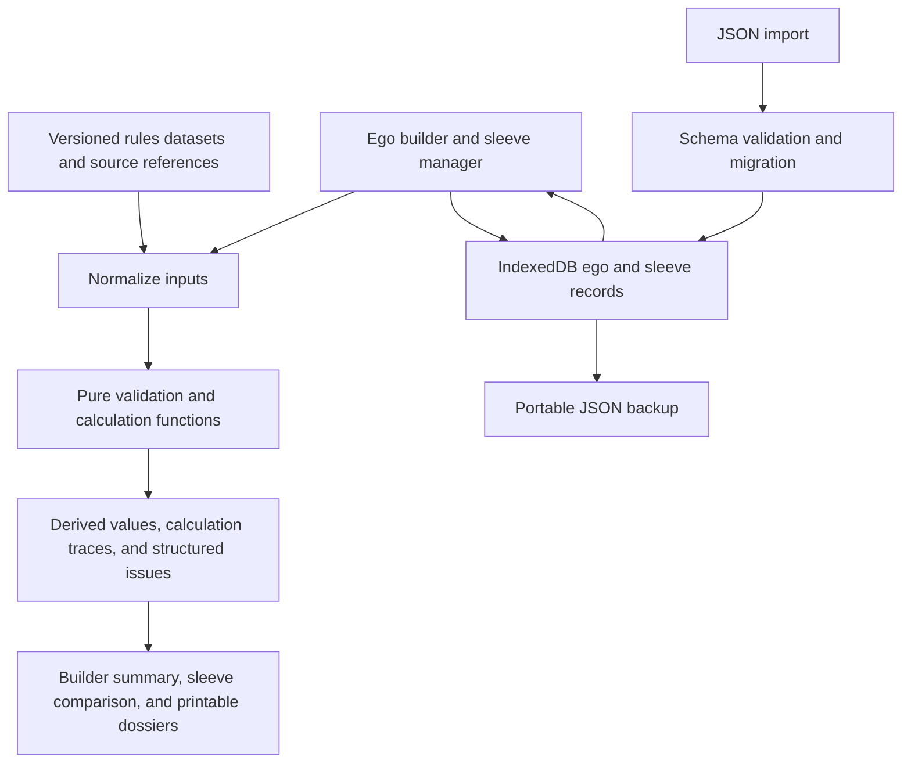

# Architecture

The [product brief](../README.md) proposes a TypeScript React application with shadcn/ui and Tailwind CSS. The host framework is open. The components and paths below are proposed design boundaries for implementation.

## Data and responsibilities

| Boundary | Proposed location | Responsibility |
| --- | --- | --- |
| Application screens | `src/app/` | Dashboard, ego workspace, morph library, and reference navigation. |
| Presentation | `src/components/` | Builder controls, calculation breakdowns, morph comparison, and dossier layouts. |
| Character workflows | `src/features/` and `src/types/` | Ego creation, sleeve assignment and history, and import/export flows. |
| Rules and provenance | `src/rules/` | Versioned datasets and sources, pure calculations, and character validation. |
| Persistence and formats | `src/lib/storage/` and `src/lib/schemas/` | IndexedDB records, import schema validation, and migration handling. |
| Verification | `src/tests/` | Planned calculation, component, and end-to-end coverage. |

An `Ego` holds portable identity and character choices. A `MorphDefinition` holds sourced base body data. A `Sleeve` references both and records individual configuration and resleeving details. Assigning a new morph creates a new sleeve while preserving earlier sleeve records. `DerivedCharacter` represents the calculated view. The TypeScript interfaces in the README are planning sketches.

The rules engine should accept incomplete drafts and report issues with severity, message, affected field, and a source reference when available. Derived values carry their contributing inputs and modifiers. The builder, comparison view, and dossiers use these outputs to keep displayed values consistent.

Imports validate and migrate before writing to local storage. A malformed backup must leave existing characters intact. Saved records carry an explicit rules version so future changes can be migrated. Player and GM dossier layouts apply the user’s private-note selection before browser printing.

For a rules change, confirm the source, update the dataset or pure function, verify the trace and affected constraints, then check the builder and dossier consumers. See [Development](development.md) and [Decisions](decisions.md).
