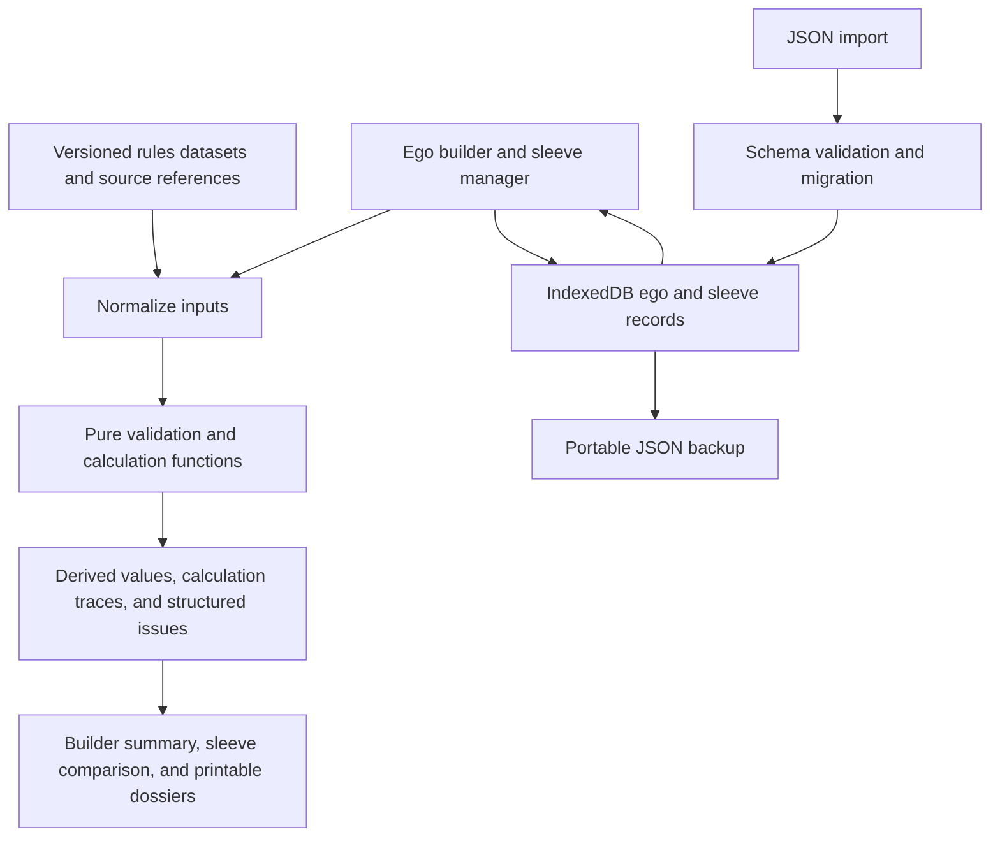

# Architecture

The prototype is a Vite-hosted React and TypeScript single-page application using Tailwind CSS and source-owned UI primitives. `src/main.tsx` mounts React Router. `src/app/routes.tsx` maps browser paths to screens, and `src/app/App.tsx` supplies the workspace shell and local draft data.

The dashboard uses `/`, the morph library uses `/morphs`, and backup import uses `/backups/import`. Ego creation uses `/egos/new`. A saved ego uses `/egos/:egoId` and the nested `edit`, `resleeve`, and `print` routes. The ego route looks up the id in IndexedDB-backed workspace data. Unknown URLs and unavailable egos have separate recovery screens. The workspace guards in-app navigation with unsaved changes and uses the browser unload prompt for reloads and other document navigations.

The editor validates aptitude entries through `src/rules/calculations/draft.ts` and commits the ego and optional first sleeve together through `src/lib/storage/drafts.ts`. The IndexedDB transaction checks the draft’s revision before writing so stale edits cannot overwrite a newer draft. The dossier derives aptitude checks from the ego and loads morph health values independently from `src/rules/datasets/sample-morphs.ts`. Legacy morph ids are retained for old drafts. New assignments use the [Quick-Start profiles](rules-sources.md).

The draft editor reads published aptitude arrays from `src/rules/datasets/aptitude-templates.ts`. `src/rules/calculations/aptitude-budget.ts` reports the applied total, remaining template points, and CP spent on aptitudes. The ledger is advisory during drafting. Template application stores the resulting aptitude scores in the existing ego schema.

The editor reads starter packages from `src/rules/datasets/creation-packages.ts`. The ego stores optional selections as stable ids, plus player-entered Know fields and a faction motivation. Grants are resolved from the versioned dataset. The backup parser validates each id in its category and checks its field slots against that package. Earlier drafts and backups can omit the optional package selections.

`src/rules/calculations/starting-skills.ts` matches named Know fields without regard to case or extra spaces and sums each skill’s grants with their source labels. The ledger derives the aptitude base and over-cap amount. The ego and its backup may include optional Art classifications for player-entered Know fields. Missing aptitudes leave totals pending, and unnamed Know grants remain unassigned.

An ego may also store ordered skill-point transfers. The calculation replays each move against current grants and aptitudes, with separate checks for source balances, Know destinations, and the standard starting cap. A valid transfer can create a ledger row for a supported Active skill or a named Know field. Later moves can spend the points in that row. Invalid moves have no effect and remain visible for review. Backups preserve the ordered moves and any new Know field names. Derived allocations are recalculated when a draft opens.

Skill purchases are stored as a separate ordered list and applied after package transfers. The ledger keeps purchased and package points separate and checks their combined total against the skill cap. The shared CP budget counts all saved purchase points in groups of five and adds aptitude costs. A purchase awaiting review still reserves its points until the player removes it or resolves the issue.

Ego Flex and language choices are optional ego fields in drafts and JSON backups. Older drafts default to one ego Flex and an empty language list. The CP budget derives Flex cost from the selected total and language cost from the current Cognition and Intuition scores. Flex in this calculation belongs to the ego and carries across sleeves.

Reputation is an optional map from supported network IDs to starting scores. Drafts preserve explicit zeroes and omitted networks. The editor and backup validation share the 0–80 range. The CP budget derives cost from the total above the 100 free points and shows the balance of each five-point purchase.

Specializations store the ledger skill ID and a name. The calculation adds the situational +10 to the current skill total after applying the starting cap checks. The budget charges one CP per saved choice. Choices whose skill disappears remain available for review and are omitted from both print layouts.

Ego trait selections store a source ID and a level. The shared budget looks up positive costs and negative bonuses from the rules dataset. The editor and backup validator enforce the six-CP negative trait limit. The dossier and print layouts show situational effects as reference text.

Draft schema version 2 stores sleeves in save order, with the last sleeve active. `src/features/sleeve/history.ts` reads version 1 drafts by putting any existing sleeve at the start of that history. Resleeving appends a new sleeve and optional event details in the same transaction as the revision update. A recorded event date can precede a previous event without changing which sleeve is active.

JSON backups use the `eclipse-phase-character-backup` format with an envelope version and a list of draft records. `src/features/backup/backup.ts` validates the envelope and all records before offering a preview. It normalizes draft schema 1 into schema 2 and reports how many records were converted. Restoration assigns new ego and sleeve ids, preserves the original content and timestamps, and writes the full batch in one IndexedDB transaction using insert-only operations.

`src/features/dossier/print.ts` builds a printable view from the saved draft and the current audience and field choices. Player output carries the active morph and ego checks. GM output adds a compact check summary and sleeve history, with optional event dates, locations, causes, and notes. Only selected fields reach the preview markup, which doubles as the browser’s print content.

The diagram and component boundaries below describe the planned release and show the existing backup flow.

## Data and responsibilities

| Boundary | Proposed location | Responsibility |
| --- | --- | --- |
| Application screens | `src/app/` | Dashboard, ego workspace, morph library, and reference navigation. |
| Presentation | `src/components/` | Builder controls, calculation breakdowns, morph comparison, and dossier layouts. |
| Character workflows | `src/features/` and `src/types/` | Ego creation, sleeve assignment and history, and import/export flows. |
| Rules and provenance | `src/rules/` | Versioned datasets and sources, pure calculations, and character validation. |
| Persistence and formats | `src/lib/storage/` and `src/lib/schemas/` | IndexedDB records, import schema validation, and migration handling. |
| Verification | `src/tests/` | Planned calculation, component, and end-to-end coverage. |

An `Ego` holds portable identity and character choices. A `MorphDefinition` holds sourced base body data. A `Sleeve` references both and records individual configuration and resleeving details. Assigning a new morph creates a new sleeve while preserving earlier sleeve records. `DerivedCharacter` represents the calculated view. The TypeScript interfaces in the README are planning sketches.

The rules engine should accept incomplete drafts and report issues with severity, message, affected field, and a source reference when available. Derived values carry their contributing inputs and modifiers. The builder, comparison view, and dossiers use these outputs to keep displayed values consistent.

Imports validate and migrate before writing to local storage. A malformed backup leaves existing characters intact. Saved records carry an explicit rules version so future changes can be migrated.

For a rules change, confirm the source, update the dataset or pure function, verify the trace and affected constraints, then check the builder and dossier consumers. See [Development](development.md) and [Decisions](decisions.md).
