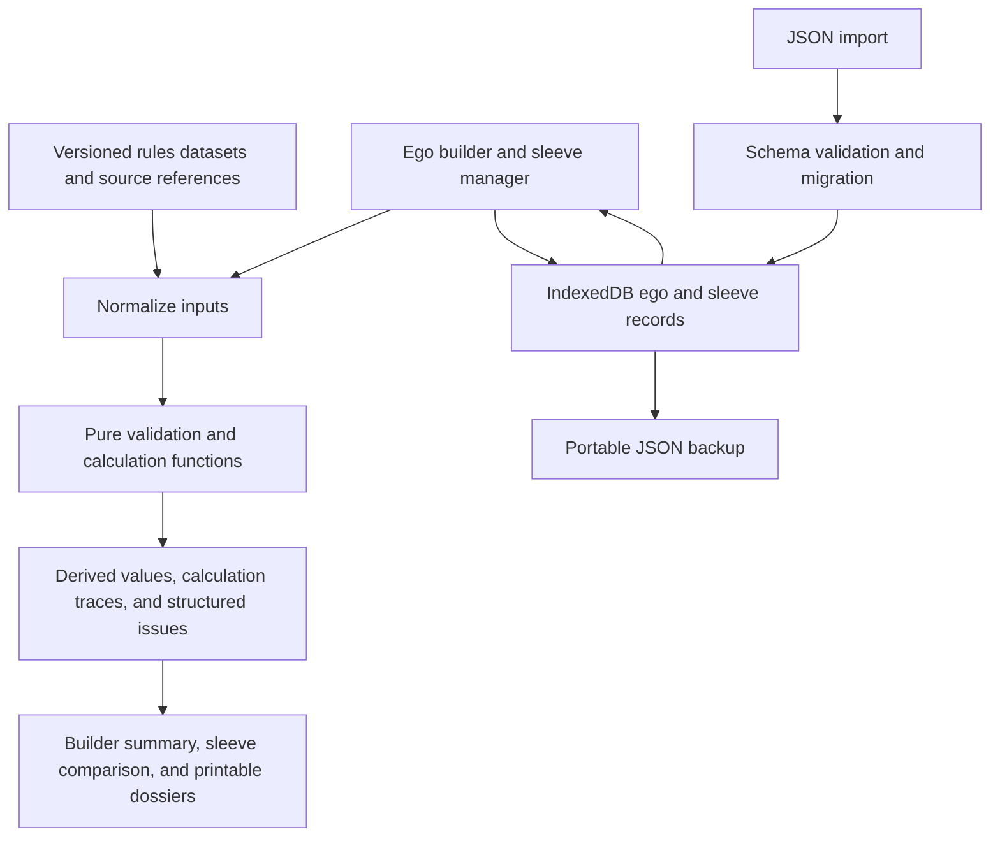

# Architecture

The prototype is a Vite-hosted React and TypeScript single-page application using Tailwind CSS and source-owned UI primitives. `src/main.tsx` mounts React Router. `src/app/routes.tsx` maps browser paths to screens, and `src/app/App.tsx` supplies the workspace shell and local draft data.

A shared top navbar contains the brand, My egos, Morph library, Import JSON, Create ego, and the local workspace indicator. It replaces the sidebar and separate status bar. The navbar wraps into two columns of links on phones, keeps native links and visible focus styles, and is hidden in print. Create and import actions are available from every screen; workspace backup export remains beside the saved drafts on the dashboard. Navigation continues through the same unsaved-edit and save-in-progress guards. The UI has no Prototype badge.

The dashboard uses `/`, the morph library uses `/morphs`, and backup import uses `/backups/import`. Ego creation uses `/egos/new`. A saved ego uses `/egos/:egoId` and the nested `edit`, `resleeve`, and `print` routes. The ego route looks up the id in IndexedDB-backed workspace data. Unknown URLs and unavailable egos have separate recovery screens. The workspace guards in-app navigation with unsaved changes and uses the browser unload prompt for reloads and other document navigations.

The editor validates aptitude entries through `src/rules/calculations/draft.ts` and commits the ego and optional first sleeve together through `src/lib/storage/drafts.ts`. The IndexedDB transaction checks the draft’s revision before writing so stale edits cannot overwrite a newer draft. The dossier derives aptitude checks from ego scores and modifiers on the ego and its active sleeve. The seven supported profiles provide published health, MP prices, pools, built-in ware, and included traits. Bouncer, Case, and Synth retain their matching Quick-Start health sources alongside their core player profiles. Legacy morph IDs are retained for old drafts. [Rules sources](rules-sources.md)

`reviewCreation` in `src/rules/calculations/creation-review.ts` projects the editor's parsed input, customization choices, budgets, derived gear, skill ledger, and Psi trace into issues with an ID, severity, message, and focus target. The budget, gear, and skill panels consume the same results. Review links focus and scroll to the destinations within the editor. Its count updates through a status region. The save handler enforces input errors and accepts drafts with advisory issues.

`traceDerivedEgoStats` derives Initiative, Lucidity, Trauma Threshold, and Insanity Rating from aptitude scores and verified ego trait modifiers. Its rule constants and source links live in `src/rules/datasets/derived-stats.ts`. Each result records its formula, input sources, calculation, modifier sources, and total. Division uses normal nearest-integer rounding. Composure adds five Lucidity and Instability subtracts five per level before Trauma Threshold and Insanity Rating are calculated. The formula shows each signed contribution, including when they cancel. A missing required aptitude leaves dependent values pending. The shared `EgoDerivedStats` component renders the trace in the live editor, saved dossier, and both print layouts. Derived values are recalculated from the stored draft, so existing drafts and backups need no schema change.

The draft editor reads published aptitude arrays from `src/rules/datasets/aptitude-templates.ts`. `src/rules/calculations/aptitude-budget.ts` reports the applied total, remaining template points, and CP spent on aptitudes. The ledger is advisory during drafting. Template application stores the resulting aptitude scores in the existing ego schema.

The editor reads starter packages from `src/rules/datasets/creation-packages.ts`. The ego stores optional selections as stable ids, plus player-entered Know fields and a faction motivation. Grants are resolved from the versioned dataset. The backup parser validates each id in its category and checks its field slots against that package. Earlier drafts and backups can omit the optional package selections.

All 16 core interests are available. Pilot uses separate `pilot-1` and `pilot-2` field slots for its 30- and 40-point grants; other packages keep their existing `pilot-1` slot. Both fields use the existing sample/custom field resolver and merge when they name the same skill. Unfilled slots stay pending, and changes replay saved allocations against the resulting ledger. Interest additions require no storage schema change. Async’s Psi points require the Psi trait.

`src/rules/calculations/starting-skills.ts` matches named Know fields without regard to case or extra spaces and sums each skill’s grants with their source labels. The ledger derives the aptitude base and over-cap amount. The ego and its backup may include optional Art classifications for player-entered Know fields. Missing aptitudes leave totals pending, and unnamed Know grants remain unassigned.

An ego may also store ordered skill-point transfers. The calculation replays each move against current grants and aptitudes, with separate checks for source balances, Know destinations, and the standard starting cap. A valid transfer can create a ledger row for a supported Active skill or a named Know field. Later moves can spend the points in that row. Invalid moves have no effect and remain visible for review. Backups preserve the ordered moves and any new Know field names. Derived allocations are recalculated when a draft opens.

Skill purchases are stored as a separate ordered list and applied after package transfers. The ledger keeps purchased and package points separate and checks their combined total against the skill cap. The shared CP budget counts all saved purchase points in groups of five and adds aptitude costs. A purchase awaiting review still reserves its points until the player removes it or resolves the issue.

Allocations to custom Active fields carry their category, display name, and linked aptitude. A normalized category and field name identify the ledger row and its specializations. Incoming allocations preserve the field definition so a later purchase can still establish the row after an earlier transfer is removed.

Package Active field slots use the same skill IDs as transfers and purchases. A named Hardware or Pilot field resolves to a sample ID when one matches, or to a custom ID with the same category’s aptitude. Blank Active slots track pending points separately from blank Know slots.

All ten core backgrounds are supported. Lost’s Psi points require the Psi trait. Indenture and Underclass use a restricted combat-skill slot stored in the existing package `fields` map. The dataset supplies the allowed skills, the editor renders a native select, and the ledger assigns the grant only to a valid choice. Blank or unsupported choices stay pending as Active points. Backup import accepts blank choices, trims selected values, and rejects selections outside the package's allowed list. Changing a choice replays the saved transfers and purchases against the updated ledger. No draft schema change is needed.

Personal motivations use three optional ego slots with a stance and text. A named faction supplies the first displayed motivation from its stored override or the default interests label. It reserves the third personal slot for use without a faction. Legacy Factionless text is read into the third slot and moves there when the draft is saved. The player print layout shows the currently active choices.

The faction dataset contains the core book's 15 broad affiliations and six concrete regional affiliations, plus Factionless. Regional entries share a dataset group for a native select optgroup; the selected id is still stored in the existing package selection. Named factions supply a fixed 30-point Know grant and an editable motivation default. Anarchist, Argonaut, and Factionless retain their original ids and grants. Faction changes reset that choice's custom motivation and goal while preserving personal motivations. A defector's old-faction knowledge can be represented by the existing Know transfer mechanism without changing allegiance. No storage schema change is needed.

Optional goals travel with their personal slot or named faction choice. Drafts and backups can retain a goal for an unnamed personal slot. The dossier and player print layout display goals alongside their active, named motivations.

Starting gear stores the chosen campaign on the ego. The loadout derives the career pack from the selected career and uses the first sleeve to resolve campaign and career pack synthmorph alternatives, including the Soldier pack's Meds-to-Fixer-Swarm replacement. Gear Point totals are source values. The calculation leaves the Customization Point budget independent of starting packs. Pack item effects are reference data and do not modify derived checks or pools.

The career dataset contains all 14 core careers with matching gear packs. Covert Operative uses the same first-sleeve alternative mechanism to replace Skinflex with Synthetic Mask. Gear items can carry a source cost qualifier, currently the Genehacker Pusher Swarm's additional payload cost. The derived pack flags that qualifier so the editor, dossier, and player print view label the sum as base GP and retain the unresolved cost text.

An optional `startingGearSwaps` array records the effective pack ID, original item name, and replacement name. `deriveStartingGear` applies first-sleeve alternatives before resolving swaps against the supported pack and Gear chapter entries. Only fixed-cost items of equal GP can replace one another. The derived item supplies the replacement's source and restriction and preserves the original slot for display. The editor warns about inactive choices and saves the applicable ones. Backup import validates every swap against the normalized draft's first sleeve and rejects duplicate slots. Earlier draft and backup versions can omit the field.

The optional `startingInfomorphPack` flag selects the Infomorph pack for the campaign slot while retaining the recorded campaign and career. The calculation and backup validator use the first sleeve's category for eligibility. The swap catalogue includes the optional pack's items for infomorph starts. The flag stays on the ego through later resleeving.

The optional `startingMorphPoints` field stores the GM's base allowance. The calculation defaults to 6, adds the validated Resources level and up to 6 MP from eligible negative morph traits, then subtracts the first sleeve's listed cost, extra equipment, and positive morph traits. When the first sleeve cost is missing, the balance stays pending. The remainder grants one temporary Flex per complete pair of MP, up to three. A second sleeve history entry expires this bonus. The dossier and print layouts keep the original costs available for reference. Backup validation shares the allowance rules with the editor.

Each sleeve can store a `morphTraits` array of trait IDs and levels. The editor sets the first sleeve's choices and preserves later sleeve records. The morph trait dataset defines MP and eligible profiles by level. The shared calculation keeps each eligible level's published number, so the editor and backup importer agree even when a sleeve can only take Level 2. Toughness and Frailty contribute signed Durability adjustments to configured health. The editor traces those contributions from the base profile and derives Wound Threshold and Death Rating from the resulting Durability. The catalogue still displays base profiles. The dossier, resleeving comparison, and print use configured active health. Backup import rejects ineligible levels, duplicates, and excess MP bonuses.

The optional `includedTraits` list belongs to `MorphDefinition`. Views resolve it alongside the sleeve's profile ID, so existing sleeves gain the sourced traits on load. The shared eligibility check excludes included trait IDs from customization. The MP budget counts eligible additions from `morphTraits`. The library, dossier, and print use the same descriptions and rule links for included traits.

The optional `startingEquipment` array records one catalogue ID per extra item. Repeated IDs represent additional units. The editor groups the catalogue by gear category and filters it by name or category. The Add action uses the visible selection. The trace groups purchases by ID and looks up the Step 12 MP cost from each item's complexity. The same dataset supplies Gear chapter swap options at their listed GP values. Equipment variants with distinct prices have their own catalogue IDs and swap names. Backup import rejects unknown IDs. Item names, costs, source links, quantities, and the derived MP total are reconstructed from the saved IDs.

Ego Flex and language choices are optional ego fields in drafts and JSON backups. Older drafts default to one ego Flex and an empty language list. The CP budget derives Flex cost from the selected total and language cost from the current Cognition and Intuition scores. Flex in this calculation belongs to the ego and carries across sleeves.

Reputation is an optional map from supported network IDs to starting scores. Drafts preserve explicit zeroes and omitted networks. The editor and backup validation share the 0–80 range. The CP budget derives cost from the total above the 100 free points and shows the balance of each five-point purchase.

Specializations store the ledger skill ID and a name. The calculation adds the situational +10 to the current skill total after applying the starting cap checks. The budget charges one CP per saved choice. Choices whose skill disappears remain available for review and are omitted from both print layouts.

Ego trait selections store a source ID and a level. The shared budget looks up positive costs and negative bonuses from the rules dataset. The editor and backup validator enforce the six-CP negative trait limit. The dossier and print layouts show situational effects as reference text.

The shared aptitude trait dataset links each check bonus or penalty to an aptitude and a signed per-level modifier. The ego rules apply CP pricing and the morph rules apply MP pricing. `traceAptitudeChecks` adds the applicable ego and sleeve modifiers after multiplying the aptitude score by three. It records each source, level, and contribution, with morph sources labeled separately. A missing score leaves the target pending even when a modifier is known. The editor traces the first sleeve, and the dossier and both print layouts trace the active sleeve. The stored aptitude, skill bases, free-language thresholds, and aptitude CP calculation use the original scores. Persistence and backup validation use the trait ID and level on the relevant record.

Expert Training also stores the chosen ledger skill ID. The calculation applies its 90-point cap to that skill at each transfer and purchase. Changing or removing the trait replays the same saved allocations against the updated cap.

Contact and Morph Familiarity are repeatable scoped ego traits. Their selections add `detail` for a contact name or morph type, and Contact also requires a supported reputation `network`. Each entry costs one CP. A shared key normalizes Unicode, whitespace, and case and combines the trait id, detail, and network; the editor and backup parser reject duplicate scopes. Other traits remain unique by id, including Expert Training. The summary uses these keys to render repeated purchases separately in the dossier and both print layouts. Additive optional fields preserve existing version 2 drafts and backup version 1 records. Contact's bonus is situational. The resleeving preview recognizes Morph Familiarity by comparing the normalized detail with the proposed profile name.

`traceResleevingTests` starts with SOM and WIL Check traces for the proposed sleeve. It adds Adaptability and Morphing Disorder to both tests, and the proposed sleeve's Exotic Morphology to Integration. Morph Familiarity can waive Integration. The Exotic Morphology waiver is local to the selected preview. Saving persists the sleeve and event details through the existing IndexedDB transaction.

Hardening uses the same repeatable detail field with a restricted stress type. Alienation, Helplessness, and Violence each cost one CP. Unknown also costs one CP and requires Psi. The trait trace excludes incomplete or unsupported scopes. Each valid purchase contributes −10 to the WIL Check trace and a separate −10 Persuade Test modifier. Skill rows retain their unmodified rating and cap excess alongside `testModifiers`, their sum, and `testTarget`. Transfers and purchases enforce caps against the rating; specializations add their situational bonus to the adjusted test target. The editor, dossier, and both print layouts show the penalty sources. Mobile ledgers with modifier traces scroll within the named table region, and printed trait entries stay together across page breaks.

Draft schema version 2 stores sleeves in save order, with the last sleeve active. `src/features/sleeve/history.ts` reads version 1 drafts by putting any existing sleeve at the start of that history. Resleeving appends a new sleeve and optional event details in the same transaction as the revision update. A recorded event date can precede a previous event without changing which sleeve is active.

JSON backups use the `eclipse-phase-character-backup` format with an envelope version and a list of draft records. `src/features/backup/backup.ts` validates the envelope and all records before offering a preview. It normalizes draft schema 1 into schema 2 and reports how many records were converted. Restoration assigns new ego and sleeve ids, preserves the original content and timestamps, and writes the full batch in one IndexedDB transaction using insert-only operations.

`src/features/dossier/print.ts` builds a printable view from the saved draft and the current audience and field choices. Player output carries the active morph and ego checks. Both audiences receive the starting skill ledger from the same pure calculation used by the editor, including pending values, over-cap totals, and invalid allocation notices. GM output adds a compact check summary and sleeve history, with optional event dates, locations, causes, and notes. Only selected private fields reach the preview markup, which doubles as the browser’s print content.

The diagram and component boundaries below describe the planned release and show the existing backup flow.

## Starting Psi

The Psi trait uses the shared ego trait CP budget. The optional `psi` configuration holds a sub-strain ID and its selected drawback and free sleight. The required drawback has zero CP budget impact. The optional `psiSleightPurchases` array holds paid sleight names, including purchases made before the sub-strain is chosen. A shared trace supplies the editor, CP budget, backup validator, dossier, and both print layouts. It checks the Psi level, excludes the free sleight, and counts up to ten distinct purchases. Save persists eligible choices and backup import rejects ineligible purchases. Infection Rating is derived from the Psi level. The ledger keeps Lost and Async Psi grants pending until the trait is selected and replays Psi allocations when eligibility changes.

## Data and responsibilities

| Boundary | Proposed location | Responsibility |
| --- | --- | --- |
| Application screens | `src/app/` | Dashboard, ego workspace, morph library, and reference navigation. |
| Presentation | `src/components/` | Builder controls, calculation breakdowns, morph comparison, and dossier layouts. |
| Character workflows | `src/features/` and `src/types/` | Ego creation, sleeve assignment and history, and import/export flows. |
| Rules and provenance | `src/rules/` | Versioned datasets and sources, pure calculations, and character validation. |
| Persistence and formats | `src/lib/storage/` and `src/lib/schemas/` | IndexedDB records, import schema validation, and migration handling. |
| Verification | `src/tests/` | Planned calculation, component, and end-to-end coverage. |

An `Ego` holds portable identity and character choices. A `MorphDefinition` holds sourced base body data. A `Sleeve` references both and records individual configuration and resleeving details. Assigning a new morph creates a new sleeve while preserving earlier sleeve records. `DerivedCharacter` represents the calculated view. The TypeScript interfaces in the README are planning sketches.

The rules engine should accept incomplete drafts and report issues with severity, message, affected field, and a source reference when available. Derived values carry their contributing inputs and modifiers. The builder, comparison view, and dossiers use these outputs to keep displayed values consistent.

Imports validate and migrate before writing to local storage. A malformed backup leaves existing characters intact. Saved records carry an explicit rules version so future changes can be migrated.

For a rules change, confirm the source, update the dataset or pure function, verify the trace and affected constraints, then check the builder and dossier consumers. See [Development](development.md) and [Decisions](decisions.md).
