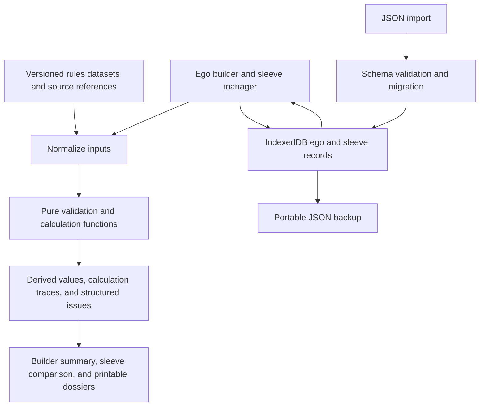

# Architecture

The prototype is a Vite-hosted React and TypeScript single-page application using Tailwind CSS and source-owned UI primitives. `src/main.tsx` mounts `src/app/App.tsx`, which renders the dashboard, editor, sample library, and dossier from `src/components/`.

The editor validates aptitude entries through `src/rules/calculations/draft.ts` and commits the ego and optional first sleeve together through `src/lib/storage/drafts.ts`. The IndexedDB transaction checks the draft’s revision before writing so stale edits cannot overwrite a newer draft. The dossier derives aptitude checks from the ego and loads morph health values independently from `src/rules/datasets/sample-morphs.ts`. Legacy morph ids are retained for old drafts. New assignments use the [Quick-Start profiles](rules-sources.md).

Draft schema version 2 stores sleeves in save order, with the last sleeve active. `src/features/sleeve/history.ts` reads version 1 drafts by putting any existing sleeve at the start of that history. Resleeving appends a new sleeve and optional event details in the same transaction as the revision update. A recorded event date can precede a previous event without changing which sleeve is active.

The diagram and component boundaries below describe the planned release, including import and backups.

## Data and responsibilities

| Boundary | Proposed location | Responsibility |
| --- | --- | --- |
| Application screens | `src/app/` | Dashboard, ego workspace, morph library, and reference navigation. |
| Presentation | `src/components/` | Builder controls, calculation breakdowns, morph comparison, and dossier layouts. |
| Character workflows | `src/features/` and `src/types/` | Ego creation, sleeve assignment and history, and import/export flows. |
| Rules and provenance | `src/rules/` | Versioned datasets and sources, pure calculations, and character validation. |
| Persistence and formats | `src/lib/storage/` and `src/lib/schemas/` | IndexedDB records, import schema validation, and migration handling. |
| Verification | `src/tests/` | Planned calculation, component, and end-to-end coverage. |

An `Ego` holds portable identity and character choices. A `MorphDefinition` holds sourced base body data. A `Sleeve` references both and records individual configuration and resleeving details. Assigning a new morph creates a new sleeve while preserving earlier sleeve records. `DerivedCharacter` represents the calculated view. The TypeScript interfaces in the README are planning sketches.

The rules engine should accept incomplete drafts and report issues with severity, message, affected field, and a source reference when available. Derived values carry their contributing inputs and modifiers. The builder, comparison view, and dossiers use these outputs to keep displayed values consistent.

Imports validate and migrate before writing to local storage. A malformed backup must leave existing characters intact. Saved records carry an explicit rules version so future changes can be migrated. Player and GM dossier layouts apply the user’s private-note selection before browser printing.

For a rules change, confirm the source, update the dataset or pure function, verify the trace and affected constraints, then check the builder and dossier consumers. See [Development](development.md) and [Decisions](decisions.md).
